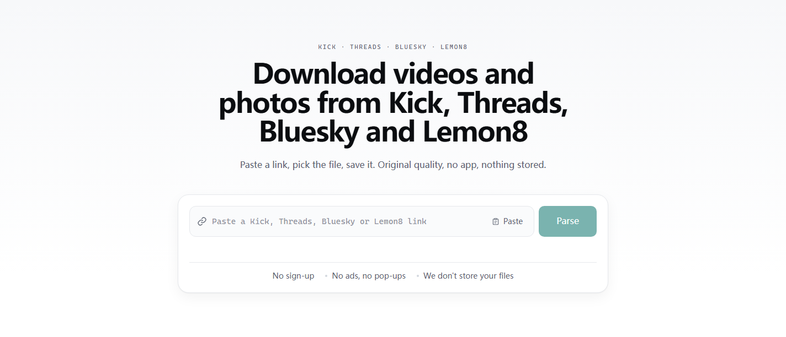
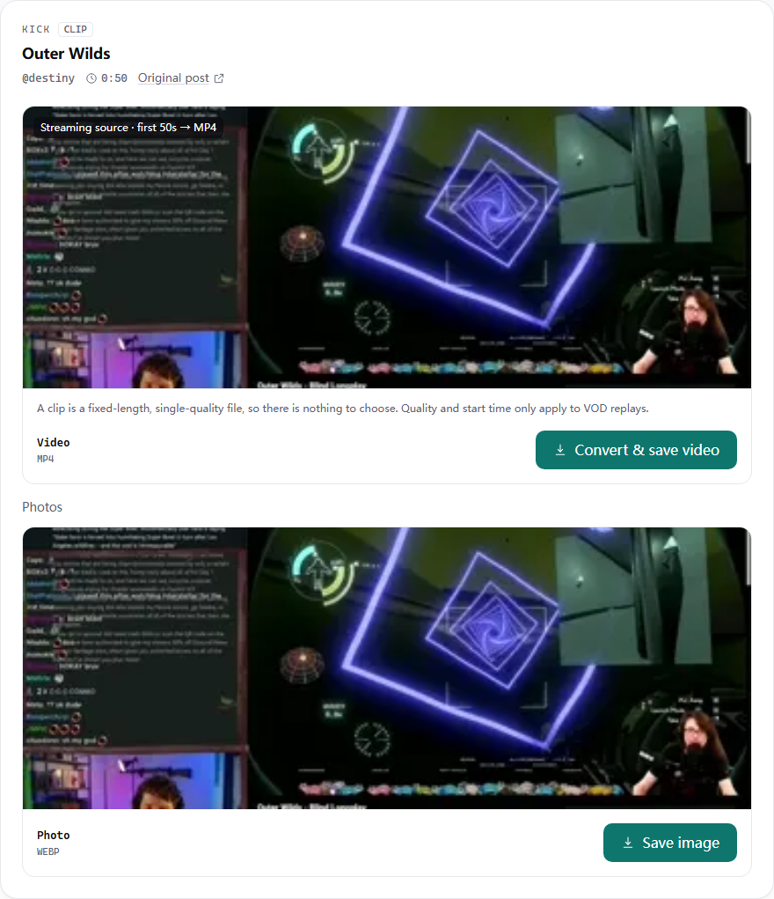
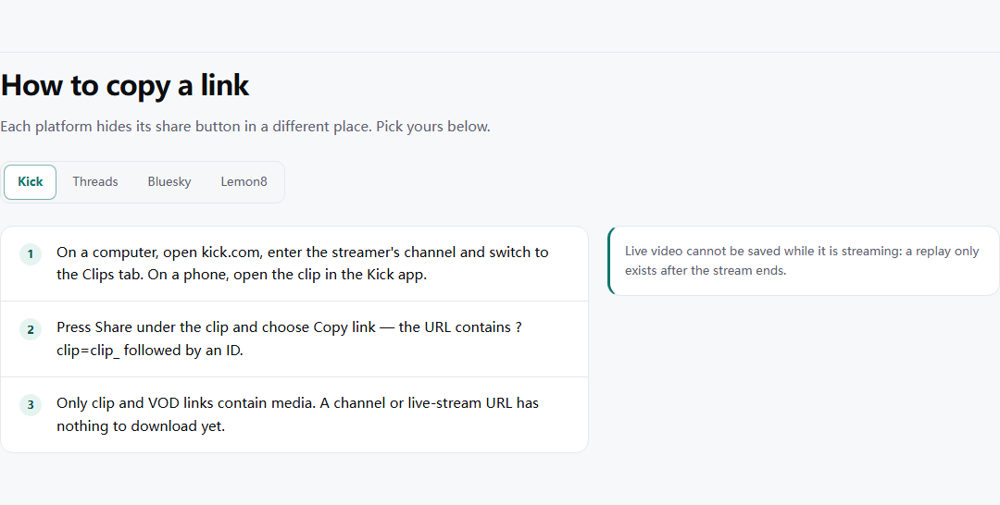
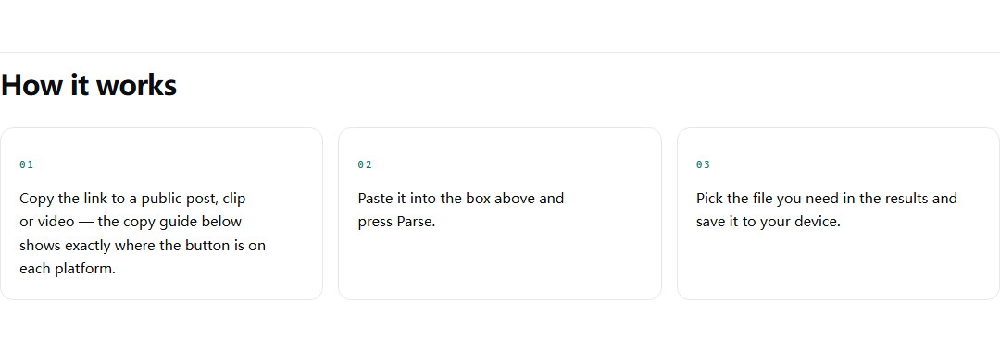
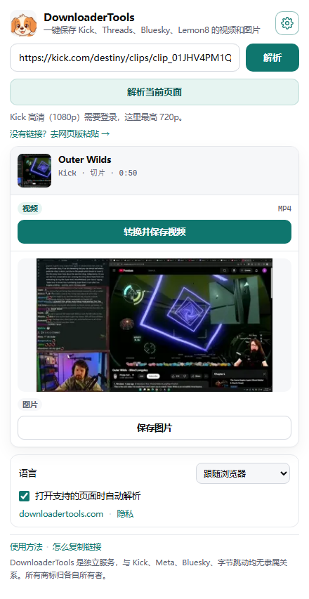
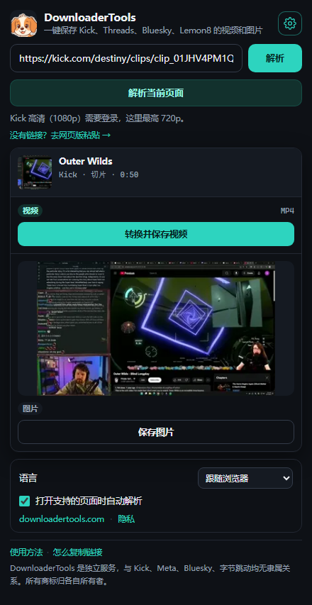

# DownloaderTools — save videos & photos from Kick, Threads, Bluesky and Lemon8

**Paste a link → pick the file → save it.** No sign-up, no app to install, no watermark, and the server never keeps your files.

[**Website**](https://downloadertools.com) · [Kick](https://downloadertools.com/kick) · [Threads](https://downloadertools.com/threads) · [Bluesky](https://downloadertools.com/bluesky) · [Lemon8](https://downloadertools.com/lemon8) · [Privacy](https://downloadertools.com/privacy)

---

## What it does

- **Four platforms, one box** — Kick, Threads, Bluesky and Lemon8 links all go into the same input.
- **Original quality** — you get the file the platform serves, not a re-encoded copy.
- **Videos, clips and photos** — HLS streams are converted to MP4 on the server so the result opens anywhere.
- **Trims VOD replays** — pick a 30-second to 5-minute window from any Kick replay.
- **Nothing to install** — it runs in the browser. A companion Chrome extension is available for one-click parsing (see below).
- **27 languages**, including right-to-left layouts for Arabic, Persian and Urdu.

---

## Supported platforms

| Platform | What you can save | Notes |
| --- | --- | --- |
| **Kick** | Clips in original quality · up to 5 minutes of any VOD replay | Kick puts 1080p behind a login wall, so **720p is the highest quality available** without an account |
| **Threads** | Videos and photos from public posts | Multi-image posts are listed one by one |
| **Bluesky** | Videos and photos from public posts | — |
| **Lemon8** | Photos, carousels and videos | — |

---

## How it works

1. **Copy the link** to a public post, clip or video.
2. **Paste it** into the box on the site and press **Parse**.
3. **Pick the file** you need and save it to your device.

Not sure where the share button is on each platform? There is a step-by-step guide for all four platforms — the site links straight to it from the popup footer, or open [downloadertools.com/#copy](https://downloadertools.com/#copy).

---

## Chrome extension

The extension does the same job without leaving the page: open a supported post, click the toolbar icon, and the popup parses the current tab for you. Conversion runs on the server, so you can close the popup and the download still finishes on its own.

| Light | Dark |
| --- | --- |
|  |  |

- Shows a real preview of what you are about to save, with a per-file button (**Convert & save video** / **Save video** / **Save image**).
- Remembers your language out of the 27 available, follows the browser by default.
- Optional auto-parse: turn it off if you don't want a request every time the popup opens.

> **Status:** the extension is in beta and is not listed on the Chrome Web Store yet.

---

## Limits (so you are not surprised)

- **Live streams cannot be saved while they are live.** A replay only exists after the stream ends.
- **Kick replays are capped at 5 minutes per file.** Pick the window you need; longer replays need several files.
- **Kick is capped at 720p.** 1080p requires a logged-in Kick session, which the service deliberately does not use.
- **Private, deleted or region-locked posts** cannot be parsed — there is nothing to fetch.
- Very large single files may hit the server's size ceiling; the error message tells you when that happens.

---

## Privacy

- **No account, no email, no password** — and nothing is sold.
- **Your files are not stored.** Media is streamed through the server to your browser; the service does not keep the files you download.
- **Aggregate counters only** — parses succeeded/failed per platform, total bytes served, no identifiers attached.
- **Error logs keep the submitted link and the failure reason for 7 days**, so broken parsers can be fixed.
- **Analytics are cookieless and aggregated**, when enabled.

Full text: [Privacy](https://downloadertools.com/privacy) · [Terms](https://downloadertools.com/terms) · [DMCA](https://downloadertools.com/dmca)

---

## FAQ

**Is it free?**
Yes — no account, no payment. Requests are rate-limited so one client cannot exhaust the server; the caps above are the only fixed limits.

**Do I need the extension?**
No. The website does everything; the extension only saves you a copy-paste.

**Why is Kick limited to 720p?**
Kick serves 1080p to logged-in viewers only. Without a session the high-quality renditions fail partway, so the service offers the quality that actually completes.

**Can I save a whole 3-hour stream?**
Not in one file. The 5-minute cap is a server-side guard; download the segments you need.

---

## Disclaimer

DownloaderTools is an independent project. It is **not affiliated with, endorsed by, or sponsored by** Kick, Meta (Threads), Bluesky or ByteDance (Lemon8). All product names, logos and trademarks belong to their respective owners.

Only download content you have the right to save. Respect copyright, the creator's wishes and each platform's terms of service.

---

## About this repository

This repository contains **no source code**. It exists to document the service and keep its screenshots in one place. Everything you can try lives at **[downloadertools.com](https://downloadertools.com)**.

Last updated: November 2026

---

### 中文简介

DownloaderTools 是一个在线下载工具：把 Kick、Threads、Bluesky、Lemon8 的公开帖子链接粘进去，选择需要的视频或图片，直接保存到本地。

- 原画质、无水印、免注册，服务器不保存你的文件；
- 支持 Kick 切片与 5 分钟以内的直播回放、Threads / Bluesky 的视频与图片、Lemon8 的图文与视频；
- 网页版即开即用，另有 Chrome 插件可一键解析当前页面（内测中）；
- 界面支持 27 种语言。

官网：<https://downloadertools.com> · 各平台链接的复制方法见 <https://downloadertools.com/zh-CN/#copy>

本项目与 Kick、Meta、Bluesky、字节跳动均无隶属关系，商标归各自所有者。请仅下载你有权保存的内容。
